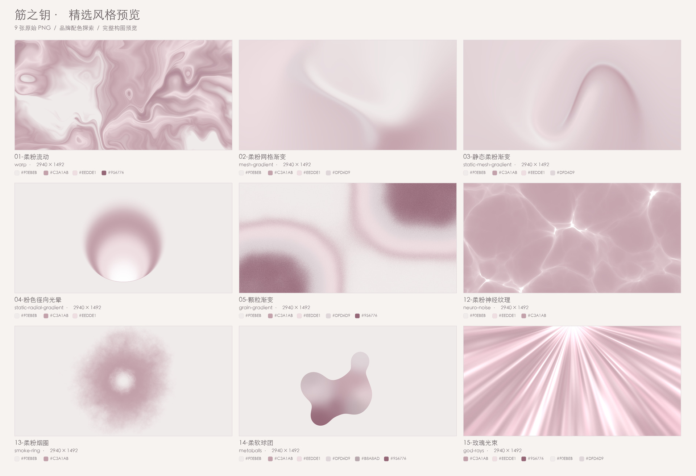
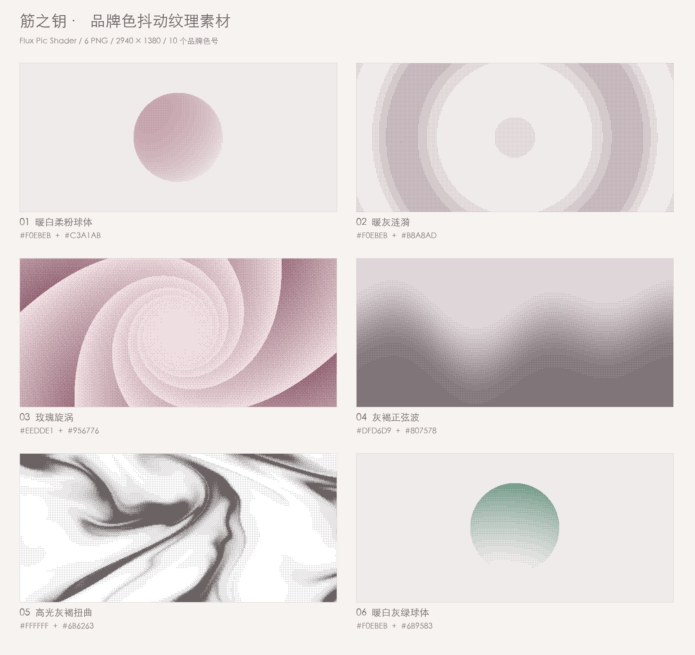
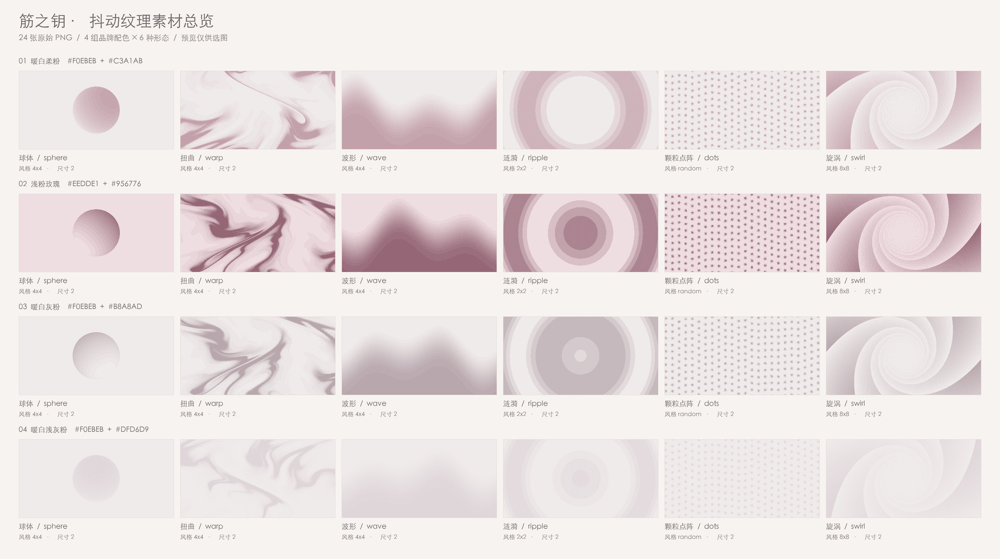
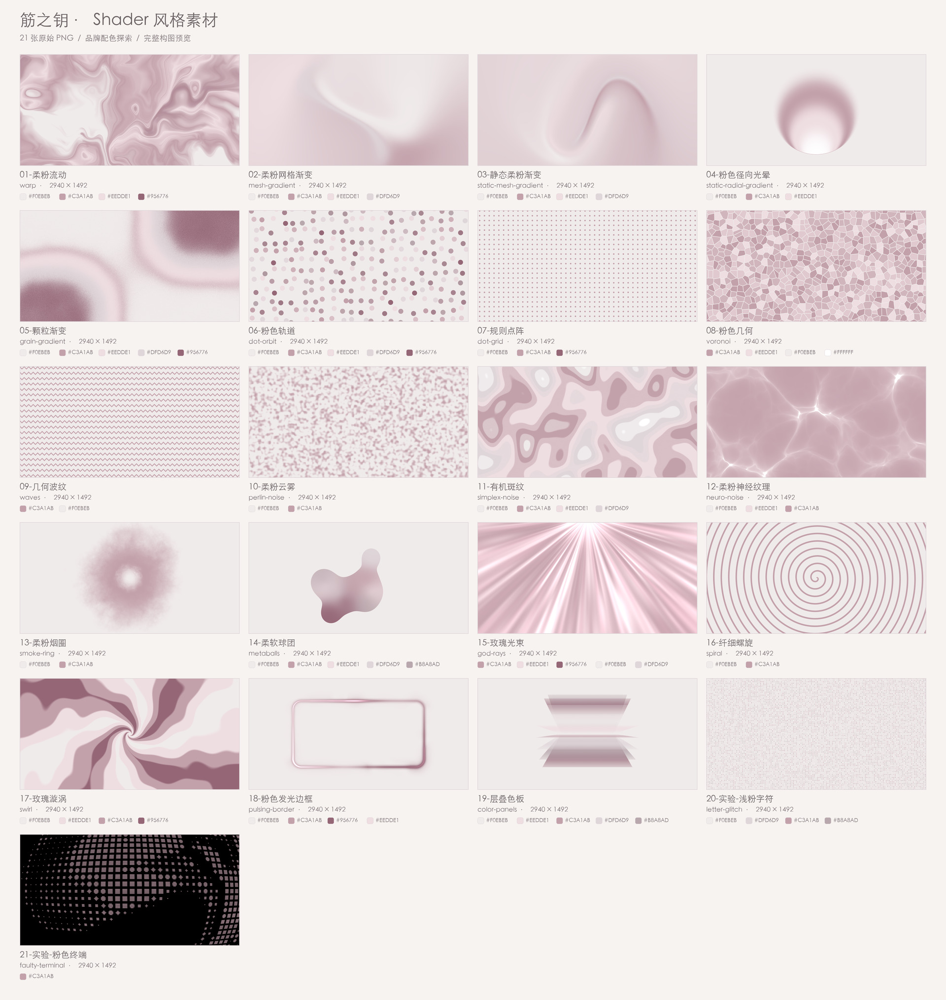

# 筋之钥 · Shader 素材

## 交互原型

[打开 Figma 交互原型 · 点击体验](https://www.figma.com/proto/aqD7EQ8RpMyE5n5nRpFa2G/Untitled?page-id=548%3A70&node-id=555-123&starting-point-node-id=581%3A1330&scaling=contain)

## 素材说明

共 **51 张静态 PNG**，来自 [Flux Pic Shader](https://shaders.fluxpic.com/)。图片保留网站原始导出的完整构图；这些是静态快照，非动图。

所有图片在 `assets/`，文件名前缀标明批次。`manifest.json` 记录配色、公开来源与用途，`palette.json` 汇总配色。

| 批次 | 内容 | 数量 | 原图尺寸 |
| --- | --- | ---: | --- |
| B01 · 2026-11-11 | 首批配色探索 | 6 | 2940 × 1380 |
| B02 · 2026-11-11 | 核心抖动纹理，4 组配色 × 6 种形态 | 24 | 2940 × 1492 |
| B03 · 2026-11-12 | 渐变、纹理、光束等 Shader 风格 | 21 | 2940 × 1492 |

B02 与 B03 的 01—19 为暖白粉色主推荐。B01 含灰褐及灰绿辅助探索，灰绿不属于核心主视觉配色。B03 的 20、21 为实验样式；21 保留黑底柔粉字符，不推荐用于品牌主视觉。

## 快速挑选

精选包含 B03 的 01、02、03、04、05、12、13、14、15。预览仅供选图，正式排版使用原始 PNG。

## 三批总览

### B01 · 首批配色探索

### B02 · 核心抖动纹理

### B03 · Shader 风格素材

